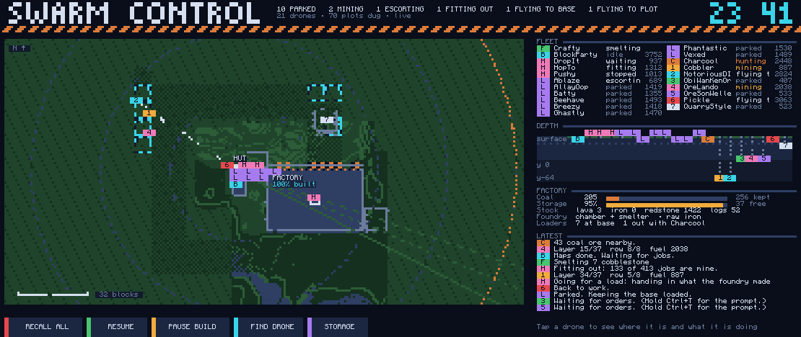
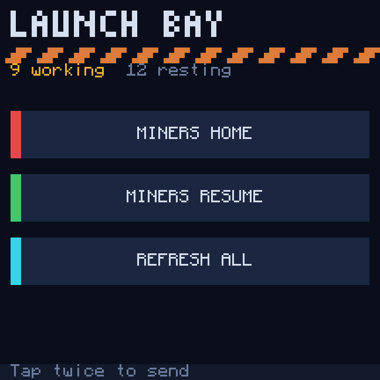
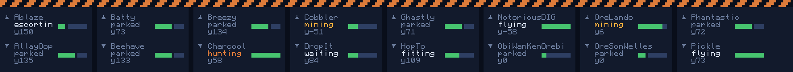

# The factory's screens

How every monitor in the factory building gets a picture, with nothing
typed into a computer and no modem to click.

## What is in the plan

73 advanced monitors, in seven screens:

| Screen | Where (plan x, y, z) | Size | Faces |
|---|---|---|---|
| Map wall | tower top floor, 46..54, 17..20, 21 | 9 x 4 | south |
| Tower touch panel | 46, 17..18, 23..25 | 3 x 2 | east |
| Launch bay touch panel | 19, 2..3, 26..27 | 2 x 2 | east |
| Rack name board | 19..26, 4, 4 | 8 x 1 | south |
| West gate lights | 0, 4, 1..2 | 2 x 1 | west (outwards) |
| East gate lights | 44, 4, 1..2 | 2 x 1 | east (outwards) |
| Storage screen | 11..15, 3..5, 29 | 5 x 3 | north (the storage plan's) |

## What is standing (16 Nov, from the status history; not checked in the world)

- **Monitors: taken to be all up.** The first fit-out (helpers' logs, 19:00 to
  19:50) left 386 jobs undone and named iron bars, ladders, lanterns, chests,
  dirt and lightning rods; no monitor was named in what was captured, and
  the gold the factory used at the time (179 to 4 ingots) covers all 73. The
  39 advanced and 21 plain monitors in stock arrived later and are spares.
- **24 of the 58 outside the storage room were put in wrongly.** A monitor placed from above lies on its
  back (screen to the ceiling) and will not join the ones beside it; one
  placed from the side faces the turtle. The first plan did not know that:
  the wall's top row (9), the whole rack board (8), half of each touch panel
  (3 and 2) and both west gate lights (2, facing into the lane) are wrong.
  So are 9 of the storage screen's 15. So the wall is a 9 x 3 with a
  strip on its back: too short for the map, which is why it would stay dark
  even with a computer.
- **No screen has a computer.** The plan had one for the tower (the
  controller, to be carried over by hand) and one for the storage desk.
- **The tower's top floor has no way in for a turtle** once fitted (ladders
  and glass all round).

`blueprints/factory_screens.txt` checks every monitor outside the storage
room and makes good what it finds: right ones are left alone.

## The design

**A station per screen.** A plain computer touching the monitor drives it
directly: no cable, no wired modem, so nothing for a player to right-click.
(A plain computer shows colour on an advanced monitor and gets its touches.)
An ender modem stuck on the computer hears every drone, since they all
broadcast their own status. Where there is a wall behind the screen the
computer goes into the wall:

| Station | Computer | Ender modem | Seen from |
|---|---|---|---|
| wall | 46, 17, 20 (in the tower's north wall) | 46, 17, 19 (outside) | outside only |
| tower panel | 45, 17, 23 (in the tower's west wall) | 44, 17, 23 (outside, over the hall roof) | outside only |
| west gate | 0, 5, 1 (in the wall over the light) | 1, 5, 1 (inside, above the lane) | the facade |
| east gate | 44, 5, 1 | 43, 5, 1 | the facade |
| rack | 22, 4, 3 (behind the board) | 22, 5, 3 (on top) | the lane |
| bay panel | 19, 4, 26 (on top of the panel) | 19, 5, 26 (on top) | the bay |

Six computers (stone, redstone, a glass pane each) and six ender modems
(8 gold and an eye of ender each: 48 gold, 6 eyes).

**Setting a computer up with no player.** The factory's floppy (in the disk
drive under the launch pad) already installs new turtles. It now also
installs a blank computer: a helper sets the computer on the pad, switches
it on, the floppy's `startup` downloads the programs, writes the role
`screen`, names it `station-<number>` and switches it off. The helper digs
it up (a named computer keeps its number and files) and carries it. Lab
verb: `bootstrap|computercraft:computer_normal|6`. The fit-out switches each
computer on where it puts it.

**Which screen am I?** `screens.lua` asks GPS where it stands and looks the
spot up in its list of posts; with no fix it goes by the size of the monitor
it touches; `.post` (or the order `post <label> name=east_gate`) overrides.
A station put down at the storage desk (13, 2, 29) turns itself into the
storage computer. Stations take the labels WallScreen, TowerPanel, BayPanel,
RackBoard, GateWest, GateEast and report as role `screen`.

**Data.** Live: the drones' own reports (protocol `swarm`), exactly what the
controller hears. Nothing heard for 90 seconds: the screen says `NO SIGNAL
SINCE hh:mm`. No radio at all: the uploaded `status.json` is read every five
minutes and the screen says it is showing the file. The GitHub token never
leaves the controller: a station has no use for it.

**Touch.** A station gives no orders. A button tapped twice within six
seconds asks the controller (protocol `swarm_panel`); the controller passes
on only what `swarm.panelOrders` lists: miners home, miners carry on,
everyone report (`ping`), everyone home, everyone carry on, builders stop.
It answers the panel and says so in chat. Nothing in the list can lose
anything.

## What each shows

- **Wall** (`dash.wall`): the map, every drone with state and fuel (two
  columns once there are more than 16), the depth gauge, coal and storage
  bars, a line each for stock, foundry and chunk loaders, the latest lines,
  and the buttons. Tap a drone for where it is and what it last said.
  
- **Touch panels** (`dash.panel`): how many are working, resting, silent or
  low on fuel, and three buttons.
  
- **Rack board** (`dash.rack`): the first sixteen drones by name, lit when
  standing in their home.
  
- **Gate lights** (`dash.gate`): OUT on the left, IN on the right; a side
  lights for six seconds when a drone reports itself on that track by the
  gate. (Nothing flies the lane yet, so they sit dark for now.)

Pictures: `python3 test/screenshots.py <status.json> <maps dir> <out dir>`.

## Orders, in order

1. Merge, push, and wait five minutes (GitHub serves `main` up to five
   minutes old, and the floppy fetches the updater from `main`). Reboot the
   factory (it rewrites the floppy on its next round), the controller (the
   panel relay) and the helper that will do the job.
2. Gold: six ender modems need 48 gold ingots.
3. `lab <helper> clear=1 ops=fetch|computercraft:computer_normal=6|dump;bootstrap|computercraft:computer_normal|6;inv`
   Expect `6 ready: station-..`. "did not set itself up" means the download
   failed or was stale: run it again a few minutes later.
4. `fit <helper> ox=-4448 oy=71 oz=1518 plan=factory_screens shell=factory_asfit3`
   72 jobs. Expect `Fit-out finished.` and no `Left:` line; six machines of
   role `screen` in the status within a minute.
5. `lab <helper> ops=handin|` (it will be carrying the spare monitors).
6. Once the storage room is fitted:
   `fit <helper> ox=-4448 oy=71 oz=1518 plan=factory_storescreen shell=factory_asfit3`
   stands the storage screen's 15 monitors up from the front.

## Not proven in the world

- A named computer dug by a turtle keeps its files (it does for a player).
- The modem sticks to the computer when the computer is straight beyond it.
- A computer with an ender modem gets a GPS fix (if not: monitor size).
- `orientation` is the name of the block state that says a monitor lies flat.

## The rebuilt factory (22 Nov)

The building this page describes was cleared on 21 Nov and rebuilt from the
`shop-full` blueprint. The posts above are the old building's. The new one
has five screens (world coordinates):

| Screen | Where | Size | Faces | Post |
|---|---|---|---|---|
| Map wall | tower, -4425..-4417, 100..103, 1538 | 9 x 4 | south | `wall` (told by its size) |
| Works board | -4461..-4457, 76, 1531 | 5 x 1 | south | `works board` |
| Front board | over the front gate, -4431..-4427, 81, 1552 | 5 x 1 | south | `front board` |
| ME hall board | over the ME desk, -4426..-4422, 73, 1545 | 5 x 1 | south | `me board` |
| Foundry board | -4384, 73, 1548..1550 | 3 x 1 | west | `foundry board` |

The four boards are a new kind of post, `board` (`dash.board`): the hall's
name in big letters, the time, the fleet counted in words, and one drone at
a time underneath. Nothing to tap.

There is no GPS at the new site, and three of the boards are the same size,
so **a board is told by its station's name**: `WorksBoard`, `FrontBoard`,
`MEBoard`, `FoundryBoard`. With any other name a 3 x 1 is taken for the
foundry board and a 5 x 1 for a plain `floor board` (titled FACTORY). A
`.post` file or a GPS fix on an old post still comes first, and no post
other than a board is ever taken on a name alone.

The map wall draws the rebuilt building: `dash.SITE` holds its outer box,
its four masses (works hall, main block, service tower, foundry), the raised
roof over the control room and the drone lane, which is still behind the
building at z 1519..1520. The hut is gone from the map. `ORIGIN` in
`screens.lua` is still the old plan's corner, because the old posts and the
rack homes on the back lane are told by it.

### The desk computers

The blueprint also has six advanced computers on desks with no monitor.
They are stations too (role `screen`), of a third kind of post, `desk`
(`dash.desk`): the picture is drawn on the computer's own screen, seen when
it is opened. It lists the fleet, a line for each drone (name, what it is
doing, fuel), pages when there are more than fit, and a click on a drone
says where it is and what it last said. A desk is told by its name:

| Name | Where |
|---|---|
| `WorksDesk` | -4462, 73, 1530 |
| `MEDesk` | -4424, 72, 1537 |
| `HangarDesk` | -4414, 79, 1532 |
| `LogisticsDesk` | -4407, 72, 1532 |
| `ControlWest` | -4425, 100, 1540 |
| `ControlEast` | -4421, 100, 1540 |

### The lobby and its doors

Behind the front gate there is now a lobby room. The ME hall's board is the
lintel over the lobby's opening into the hall (5 x 1 at -4431..-4427, 74,
1541, its station beside it at -4426, 74, 1541).

The lobby's two side doors open by themselves. Each has a station of a fourth
kind of post, `door`, with no screen at all: a computer under the doorway
with a player detector touching it and a redstone relay under the other
leaf. While a player is within `door.range` blocks of the detector (default
3) it powers every side of itself and of the relay, and for `door.hold`
seconds after (default 1.5). It opens once as it starts, so the wiring can
be seen to work. A door is told by its name:

| Name | Computer | Relay | Detector |
|---|---|---|---|
| `LobbyDoorWest` | -4436, 69, 1544 | -4436, 69, 1545 | -4436, 69, 1543 |
| `LobbyDoorEast` | -4422, 69, 1544 | -4422, 69, 1545 | -4422, 69, 1543 |
